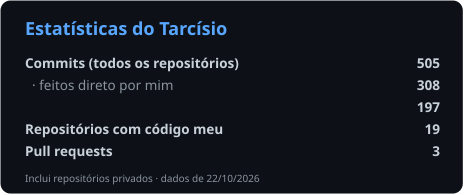
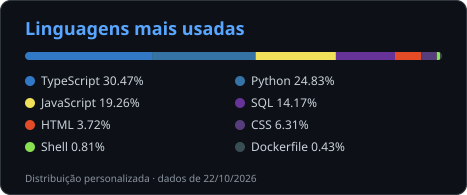

<h1 align="center">Olá, eu sou o Tarcísio 👋</h1>

  <strong>Desenvolvedor Full Stack & IA</strong> · Campos dos Goytacazes, RJ 
  Resolvo problemas reais de empresas reais com software que roda em produção.

  
  
  
  

---

### 🧭 Sobre mim

<table>
  <tr>
    <td width="50%" valign="top">
      <ul>
        <li>💼 Fundador e desenvolvedor Full Stack e de IA da <strong>Aplass</strong>, desde 2024</li>
        <li>🏢 Gerente de Operações numa rede de 4 apart-hotéis</li>
        <li>🧪 Testo o que entrego: suítes de 50 a 120 verificações por projeto</li>
      </ul>
    </td>
    <td width="50%" valign="top">
      <ul>
        <li>🔨 Construindo agora: copiloto de entrevista (extensão do Chrome + Claude API)</li>
        <li>🎓 Terminando o ensino médio (dez/2026)</li>
        <li>🌎 Português nativo · inglês intermediário/avançado</li>
      </ul>
    </td>
  </tr>
</table>

---

### 🛠️ Tech Skills

<table>
  <tr>
    <td width="140"><strong>Linguagens</strong></td>
    <td>
      
      
      
      
      
      
    </td>
  </tr>
  <tr>
    <td><strong>Front-end</strong></td>
    <td>
      
      
      
      
      
      
    </td>
  </tr>
  <tr>
    <td><strong>Back-end</strong></td>
    <td>
      
      
      
    </td>
  </tr>
  <tr>
    <td><strong>Dados</strong></td>
    <td>
      
      
      
      
    </td>
  </tr>
  <tr>
    <td><strong>IA</strong></td>
    <td>
      
      
    </td>
  </tr>
  <tr>
    <td><strong>Automação & Testes</strong></td>
    <td>
      
      
      
    </td>
  </tr>
  <tr>
    <td><strong>Ferramentas</strong></td>
    <td>
      
      
    </td>
  </tr>
</table>

---

### 🚀 O que eu já construí

| Projeto | O que é | Stack |
|---|---|---|
| [**Novera**](https://aplasscontrole.vercel.app) | SaaS de gestão de obras em produção: estoque em vários almoxarifados, compras, equipe e leitura de nota fiscal com IA | Next.js · PostgreSQL · Gemini |
| [**ProspectAI**](https://github.com/FwdexTR/prospectai) | Motor que encontra empresas locais, audita o site de cada uma e dá uma nota; analisou mais de 21 mil negócios | Python · FastAPI · DuckDB · Next.js |
| **Gestão com IA para hotelaria** | Prevê ocupação, ajusta preço da diária, atende hóspedes e organiza a escala de 4 prédios | Python · n8n · WhatsApp |
| **E-commerce de peças de moto** | Loja com API própria, painel admin, cupons e frete por CEP | React · Vite · Node.js · SQLite |
| **Copiloto de entrevista** *(em construção)* | Extensão do Chrome que lê as legendas do Google Meet e sugere respostas | JavaScript · Claude API |

---

### 📊 Estatísticas no GitHub

  
  

  <strong>Também programo em:</strong> C# · Java

---

  <em>Quase nada do que eu faço é exercício: é sistema rodando, site no ar e cliente de verdade.</em>

